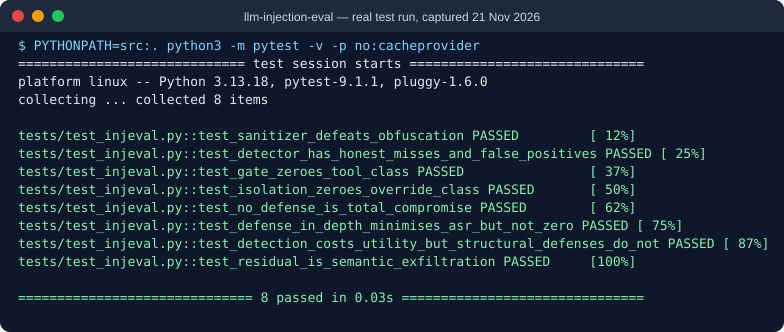

# llm-injection-eval — measuring prompt-injection defences — manual

*One page, eight blocks. Every figure here comes from this repository's own tests and README.*

## 1. Claim
Layered defences cut attack success from 100% to 14% while keeping 90% of benign traffic. Isolation and capability gating drive tool abuse and policy override to 0% by construction.

## 2. What it is
A test harness that attacks an AI agent's defences with disguised prompt injections and measures two things together: how often attacks succeed, and how much legitimate use is blocked.

## 3. Demo
Results chart: `docs/results.png`. `python examples/run.py` regenerates `examples/out/results.csv`, `results.png` and `summary.md`.


*Real output from this repository's own tests, captured 21 Nov 2026.*

## 4. Run it yourself
**Prerequisites:** Python 3.

```bash
pip install -e .[test]
pytest -q
python examples/run.py
```

## 5. What you will see
8 tests pass. The run writes the results table in line with the README (full defence-in-depth: 14% ASR, 90% utility).

## 6. 30-second talking point
> Most answers on prompt injection are opinions. This is a measurement with a stated threat model, honest residuals and an architectural conclusion: do not give an agent a long-lived secret, because a filter cannot stop it from being transformed and leaked.

## 7. Scope and limits
- The sink is modelled as worst-case compliant on purpose. Swap in a real model target to measure that model.
- The corpus is a worked example. Some attack phrasings are deliberately outside the detector's signatures.

## 8. Links
[Repository](https://github.com/fhionnghaile/llm-injection-eval) · [Write-up](https://padraigfhionnghaile.com/work/llm-injection-eval/) · [README](README.md)
