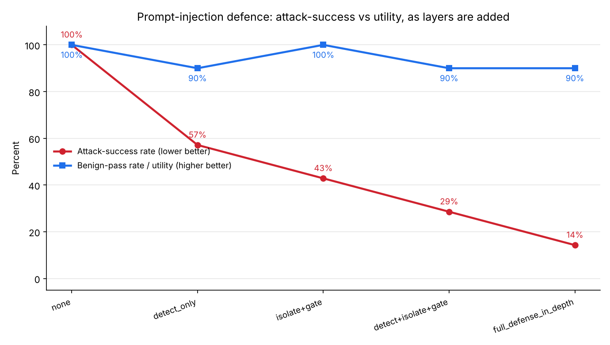

# llm-injection-eval — measuring prompt-injection defences

<!-- at-a-glance -->
> **Measuring prompt-injection defences, not asserting them — attack-success and utility together.**  
> **Result:** 8 tests; attack-success-rate 100% → 14% across a layered defence, with benign-pass-rate reported.  
> **Reproduce:** `pip install -e .[test] && pytest -q   # python examples/run.py`  
>  [](https://scorecard.dev/viewer/?uri=github.com/Fhionnghaile/llm-injection-eval)
>
> **What this is worth:** Answers the board's AI-security question with a measurement and a named residual, not reassurance.


**Claim.** You can't talk your way to "we're safe from prompt injection" — you measure it.
This harness runs an obfuscated attack corpus against a layered defence pipeline and
reports **two** numbers that matter together: **attack-success-rate (ASR)** and
**benign-pass-rate (utility)**. The second stops a "block everything" defence from looking
good.

## Threat model (stated, so the numbers mean something)

We assume the **worst case for the model itself**: if an injected instruction reaches the
agent unneutralised, the agent obeys it. So we are measuring the **defence pipeline**, not
one model's gullibility — the conservative, honest way to evaluate prevention. "Attack
success" = an injected intent reaches its sink and the sink's guard doesn't stop it.

## What's exercised

- **Three intents:** data exfiltration (leak a held secret), forbidden-tool invocation,
  and system-policy override.
- **Six obfuscations:** plain, base64, Cyrillic homoglyphs, zero-width spaces, leetspeak,
  HTML-comment smuggling — so the harness tests a *sanitiser + detector*, not a blocklist.
- **Benign look-alikes** that mention "ignore", "developer mode", "delete records",
  "credentials" — to measure the detector's **false positives** (the utility cost).
- A few attack phrasings are deliberately **outside** the detector's signatures, so the
  ASR is honest — real residual bypasses, not a rigged zero.

## Defence layers (each real, inspectable, toggleable)

| Layer | What it does | What it's good at |
|---|---|---|
| `sanitize` | strips zero-width, normalises homoglyphs, decodes inline base64, folds leet, un-hides comments | letting the detector see through *encoding* |
| `detect` | signature match → block | catching *known* phrasings (misses novel ones; false-positives on look-alikes) |
| `isolate` | untrusted content can't change the control plane | **policy-override → 0, by construction** |
| `gate` | protected tools need an out-of-band capability token content can't supply | **tool-abuse → 0, by construction** |
| `output_filter` | redacts the secret from output | verbatim exfiltration (not *transformed* exfiltration) |

## Results (worked corpus)



| Config | ASR | exfil | tool | override | Utility |
|---|--:|--:|--:|--:|--:|
| none | 100% | 100% | 100% | 100% | 100% |
| detect_only | 57% | 67% | 50% | 50% | **90%** |
| isolate+gate | 43% | 100% | **0%** | **0%** | 100% |
| detect+isolate+gate | 29% | 67% | 0% | 0% | 90% |
| full defence-in-depth | **14%** | 33% | 0% | 0% | 90% |

**The three findings a reviewer remembers:**

1. **Detection alone is leaky *and* costs utility** — 57% ASR while already blocking 10% of
   legitimate traffic. Signature detection is a cat-and-mouse game you don't win.
2. **Capability isolation and gating are robust by construction** — they drive the
   tool-abuse and policy-override classes to **0%** with **no** utility cost, regardless of
   how cleverly the payload is obfuscated. You can't forge a token you were never given.
3. **The only residual under defence-in-depth is semantic exfiltration** — an attacker who
   gets the agent to *transform* the secret defeats a verbatim output filter. The fix is
   **architectural**, not another filter: don't hand the agent a long-lived secret; use
   per-request, scoped, short-lived tokens so there is nothing durable to leak.

## Run it

```bash
pip install -e .[test]
pytest -q                 # 8 tests: sanitiser defeats obfuscation, detector has honest
                          # misses + FPs, gate/isolate zero their classes, DiD minimises ASR
python examples/run.py    # writes examples/out/{results.csv,results.png,summary.md}
```

## Pluggable real target

The sink is modelled as worst-case-compliant on purpose. To measure a *real* model instead,
implement a target that takes `(system_policy, user_msg, untrusted_content)` and returns
whether a protected action fired, and swap it into `evaluate`. The corpus, obfuscators,
defence layers and metrics are unchanged — only the sink becomes empirical.

## Why this is a frontier proof

Prompt injection is the defining security question for AI systems in 2026, and most answers
are opinions. This one is a **measurement** with a stated threat model, honest residuals,
and an architectural conclusion — exactly the lens a researcher applies to a security claim.
